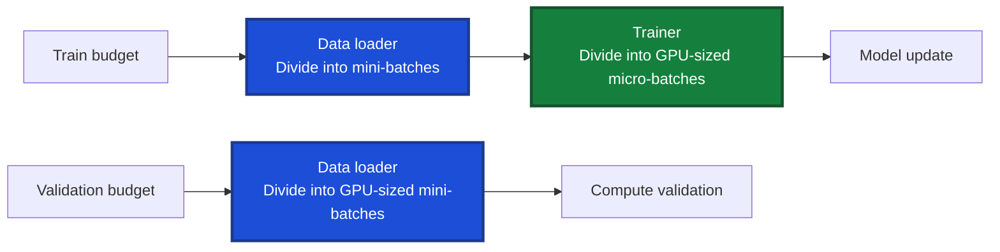

# Development notes for the GPTino project

## Data loading and training

The dataset is split into 100 shards, each containing 100M tokens. The shards are named according to the split they belong to (e.g., train, val) and are stored on disk in the `./data` directory.

A training run is defined by the token budgets `max_train_tokens` and `max_val_tokens`.

The **train budget** is divided into mini-batches of size `mini_batch_tokens`. The losses gradient is computed for each mini-batch. However, hardware constraints mean that `Batch_tokens` is usually too large to fit on a single GPU. We therefore accumulate the gradients (repeated calls to `loss.backward())`) on enough micro-batches of size `micro_batch_tokens` to reach the desired `mini_batch_tokens`. The optimizer step is then performed on the accumulated gradients.
Data is fed to the model through the **dataloader** which handles:

- Selecting the shards to cover the token budget
- Dividing the shards into mini-batches
- Iterating over the mini-batches to serve them to the model
  
Since micro-batches are a training accomodation to hardware constraints, the dataloader does not handle them. The `trainer` is responsible for splitting the mini-batches into micro-batches and accumulating the gradients.

In validation, mini-batching is not necessary since the model is not updated. So we can use the full **validation budget** in one go. However, for the same reason as in training, the validation budget is usually too large to fit on a single GPU. The dataloader will therefore divide the validation budget directly into GPU-sized mini-batches. The `trainer` will then iterate over the mini-batches to compute the validation loss.



The mini-batch size is an optimization choice, while the micro-batch size is a memory limit, so only the first constrains the configuration:

```{python}
mini_batch_tokens % (context_length * world_size) == 0
```

The dataloader checks this and computes the step count:

```{python}
steps = max_tokens // mini_batch_tokens
```

The trainer splits each mini-batch into chunks of at most `micro_batch_size` sequences. The last chunk can be smaller, so each loss is weighted by its share of the mini-batch.

## The dataloader

The **dataloader** is defined by the following parameters:

- `max_tokens`: the token budget for the dataloader. The dataloader will recycle the shards until this budget is met which means read the shards again.
- `batch_tokens`: the number of tokens in a mini-batch. The dataloader will divide the shards into mini-batches of this size.
- `world_size`: the number of GPUs used for training. The dataloader will divide the mini-batches into `world_size`. For a batch of 20 tokens, `world_size=4` means 5 tokens per process and then they aggregate to compute gradients.
- `context_length`: the number of tokens in a context window. The dataloader will divide the mini-batches into context windows of this size.

## The callbacks

Callbacks are functions that are called at specific points during training. They can be used to produce side effects, such as logging, checkpointing, or sampling. The trainer calls the callbacks at the following points:

- `on_train_begin`: called at the beginning of training
- `on_train_end`: called at the end of training
- `on_step_begin`: called at the beginning of each step
- `on_step_end`: called at the end of each step
- `on_validation_begin`: called at the beginning of validation
- `on_validation_end`: called at the end of validation

## Checkpointing

Saving the model as it trains is important for many reasons: resuming training after a crash, evaluating the model at different points in training, and sharing the model with others. In our code base saving is handled by the `CheckpointCallback` that saves the model, optimizer state, and training state (step count, random seed, etc.) at regular intervals. Depending on what we want to do with the checkpoint we can save different parts of the training state.

- **Model weights** are saved by calling `model.state_dict()` and saving the resulting dictionary to disk. This is the most common use case, as it allows us to evaluate the model at different points in training and share the model with others.
- **Optimizer state** is saved by calling `optimizer.state_dict()`. Advanced optimizer such as AdamW keep track of the moving averages of the gradients and more. Therefore starting training from scratch with a pre-trained model can lead to suboptimal results. Saving the optimizer state allows us to resume training from where we left off.
- **Training state** is saved by calling `trainer.state_dict()`. This includes the step count, random seed, and other information necessary to resume

## WIP

**Edge 1** If the token budget exceed what the shards can provide, the dataloader recycles the shards until the token budget is met. Possible overfitting.

- design question: Do we need the `{train/val}_tokens` to mean the number of distinct tokens to be processed or the total number of tokens to be processed (including duplicates)? The current implementation is the latter.-> changing the `__len__` decides the behaviour of the dataloader. defining the lenght with `needed_steps = self.max_tokens // (self.batch_tokens * self.world_size)` will make the dataloader recycle the shards until the token budget is met. Defining the lenght with `needed_steps = min(needed_steps, sum(self.steps_per_shard))` will make the dataloader stop when all shards are processed.

**decision**: we will keep the current implementation, i.e. the dataloader will recycle the shards until the token budget is met.
