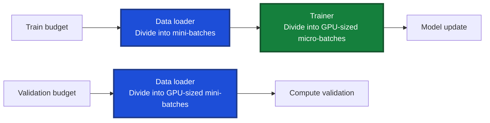

# Development notes for the GPTino project

## Data loading and training
The dataset is split into 100 shards, each containing 100M tokens. The shards are named according to the split they belong to (e.g., train, val) and are stored on disk in the `./data` directory.

A training run is defined by the token budgets `max_train_tokens` and `max_val_tokens`.

The **train budget** is divided into mini-batches of size `mini_batch_tokens`. The losses gradient is computed for each mini-batch. However, hardware constraints mean that `Batch_tokens` is usually too large to fit on a single GPU. We therefore accumulate the gradients (repeated calls to `loss.backward())`) on enough micro-batches of size `micro_batch_tokens` to reach the desired `mini_batch_tokens`. The optimizer step is then performed on the accumulated gradients.
Data is fed to the model through the **dataloader** which handles:
- Selecting the shards to cover the token budget
- Dividing the shards into mini-batches
- Iterating over the mini-batches to serve them to the model
Since micro-batches are a training accomodation to hardware constraints, the dataloader does not handle them. The `trainer` is responsible for splitting the mini-batches into micro-batches and accumulating the gradients. 

In validation, mini-batching is not necessary since the model is not updated. So we can use the full **validation budget** in one go. However, for the same reason as in training, the validation budget is usually too large to fit on a single GPU. The dataloader will therefore divide the validation budget directly into GPU-sized mini-batches. The `trainer` will then iterate over the mini-batches to compute the validation loss.

## the dataloader

**Edge 1** If the token budget exceed what the shards can provide, the dataloader recycles the shards until the token budget is met. Possible overfitting.
- design question: Do we need the `{train/val}_tokens` to mean the number of distinct tokens to be processed or the total number of tokens to be processed (including duplicates)? The current implementation is the latter.-> changing the `__len__` decides the behaviour of the dataloader. defining the lenght with `needed_steps = self.max_tokens // (self.batch_tokens * self.world_size)` will make the dataloader recycle the shards until the token budget is met. Defining the lenght with `needed_steps = min(needed_steps, sum(self.steps_per_shard))` will make the dataloader stop when all shards are processed.
**decision**: we will keep the current implementation, i.e. the dataloader will recycle the shards until the token budget is met.

## The trainer

